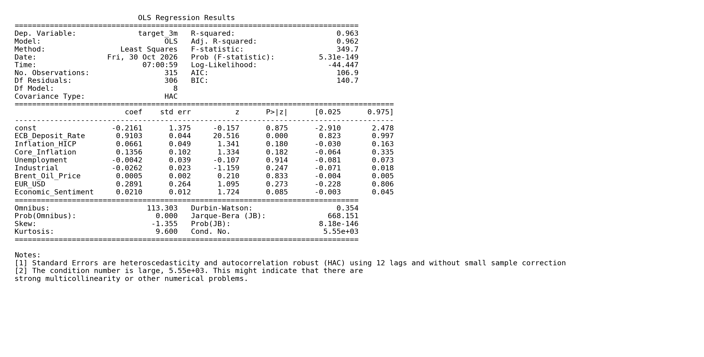

# ECB Deposit Rate Forecasting

This project examines how well the European Central Bank's (ECB) Deposit Facility Rate can be forecast three months ahead using macroeconomic indicators.
The project builds on an earlier analysis which showed that the ECB Deposit Facility Rate is highly persistent and tends to change gradually. 
This raised the question of whether macroeconomic indicators alone can provide accurate forecasts or whether including the current interest rate improves predictive performance.
More specifically the goal is to  predict the ECB Deposit Facility Rate 3 months ahead and examine the relationship its with the our macroeconomic indicators.

## Data

The dataset contains monthly observations from January 2000 to June 2026 and combines ECB interest rate data with macroeconomic indicators
(ECB Deposit Facility Rate, HICP Inflation and Core Inflation, Unemployment,Industrial Production,Brent Oil Price, EUR/USD Exchange Rate, Economic Sentiment) from the ECB and FRED.

## Forecasting Models
The analysis starts with a Ridge Regression model (Ridge A) that uses seven macroeconomic indicators to forecast the ECB Deposit Facility Rate three months ahead. 
The aim is to see how much predictive information macroeconomic variables provide on their own.
Based on the earlier analysis, we expected this model to have difficulties capturing short-term interest rate movements,
given how persistent the ECB Deposit Facility Rate tends to be. The results confirmed this expectation, with relatively weak forecasting performance.

This led to the second model (Ridge B). We kept the same seven indicators but added the current ECB Deposit Facility Rate as an additional predictor. 
The idea was to account for the persistence of the interest rate and test whether this information could improve the forecasts. T
he results showed a substantial improvement compared with Ridge A, suggesting that the current interest rate plays a much more important role in short-term forecasting than the macroeconomic indicators alone.

## Comparison Across Economic Periods

To examine whether forecasting performance depends on the economic environment, the analysis is conducted across three separate periods. This separation is particularly relevant,
because major economic events, such as the global financial crisis and the COVID-19 pandemic, had a significant impact on the ECB's monetary policy decisions. 
These external shocks led to substantial changes in the interest rate environment and may have affected the relationships between macroeconomic indicators and the ECB Deposit Facility Rate.

The sample is therefore divided into:

2000–2007: Before the global financial crisis

2008–2019: Financial crisis and low-interest-rate period

2020–2026: Pandemic, inflation and monetary policy tightening

In addition to these period-specific evaluations, all models are compared over the full sample period.

## Forecast Evaluation

Both Ridge models are compared against a naive forecast, which assumes that the current interest rate remains unchanged over the next three months.
The analysis uses a chronological 80/20 train-test split. A three-observation gap is applied between the training and test samples to account for the forecast horizon.
The predicted values are also plotted against the actual interest rate to compare how closely the models capture its development.

| Model | Train N | Test N | MAE | RMSE | R² |
|---|---:|---:|---:|---:|---:|
| Ridge A | 249 | 63 | 2.039 | 2.752 | -1.811 |
| Ridge B | 249 | 63 | 0.446 | 0.612 | 0.861 |
| Naive Forecast | 249 | 63 | 0.313 | 0.499 | 0.908 |

| Period | Model | MAE | RMSE | R² |
|---|---|---:|---:|---:|
| 2000–2007 | Ridge A | 0.190 | 0.222 | 0.740 |
| 2000–2007 | Ridge B | 0.172 | 0.194 | 0.801 |
| 2000–2007 | Naive Forecast | 0.237 | 0.281 | 0.584 |
| 2008–2019 | Ridge A | 1.205 | 1.223 | -1257.831 |
| 2008–2019 | Ridge B | 0.790 | 0.803 | -541.811 |
| 2008–2019 | Naive Forecast | 0.010 | 0.032 | 0.130 |
| 2020–2026 | Ridge A | 1.007 | 1.031 | -105.264 |
| 2020–2026 | Ridge B | 0.295 | 0.345 | -10.869 |
| 2020–2026 | Naive Forecast | 0.167 | 0.289 | -7.333 |

Note: Lower MAE and RMSE indicate better forecasting performance, while higher R² indicates a better fit.

### OLS Regression

An additional OLS regression examines the relationship between the current ECB Deposit Facility Rate, the seven macroeconomic indicators and the rate three months ahead.

The estimated specification is:

$$
\begin{aligned}
Rate_{t+3} =\ &\beta_0 + \beta_1 Rate_t \
&+ \beta_2 HICP_t + \beta_3 CoreInflation_t \
&+ \beta_4 Unemployment_t + \beta_5 Industrial_t \
&+ \beta_6 Brent_t + \beta_7 EURUSD_t \
&+ \beta_8 Sentiment_t + \varepsilon_{t+3}
\end{aligned}
$$

HAC (Newey-West) standard errors with 12 lags are used to account for potential autocorrelation and heteroskedasticity in the monthly data.

### Tools and Libraries

- Python
- pandas and NumPy
- Matplotlib
- scikit-learn
- statsmodels

## Key Takeaways

The results highlight the importance of interest rate persistence when forecasting the ECB Deposit Facility Rate. 
Macroeconomic indicators alone provide limited predictive power, while including the current rate substantially improves the Ridge model.
The comparison with the naive forecast also shows how difficult it can be to outperform a simple persistence-based benchmark. 
Evaluating the models across different economic periods provides further insight into how forecasting performance changes under different monetary policy conditions.